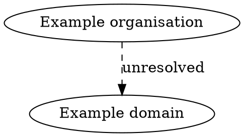

# Evidence relationships with Graphviz

Build an optional local DOT diagram from reviewed organisation and public registry observations. Use namespaced identifiers as node IDs and escaped, human-readable labels. Treat source text as plain text, and avoid images, hyperlinks and HTML labels in DOT output.

Use a solid edge for a directly sourced relationship. Use a dashed edge labelled `unresolved` for a comparison awaiting review. A shared name or domain string does not establish common ownership. Display a source publisher and date or an evidence reference alongside each asserted edge. Leave differing dates and contradictory statements visible.

Example with invented node IDs:

A locally installed Graphviz can render the DOT file with `dot -Tsvg evidence.dot -o evidence.svg`. Keep DOT and rendered outputs in the same access-controlled workspace as the evidence.
